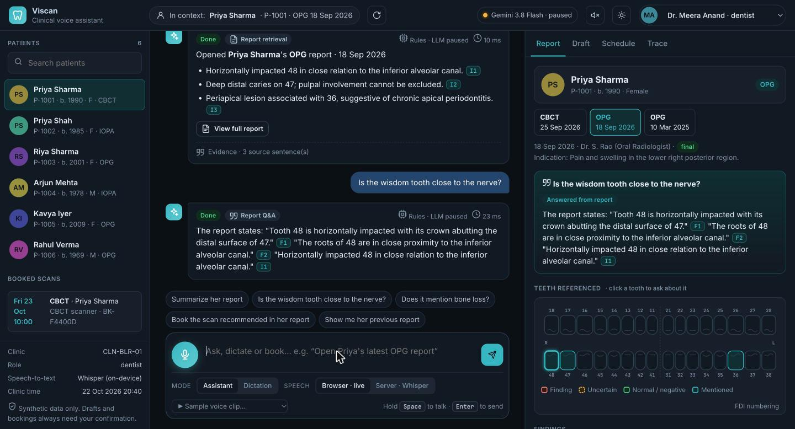
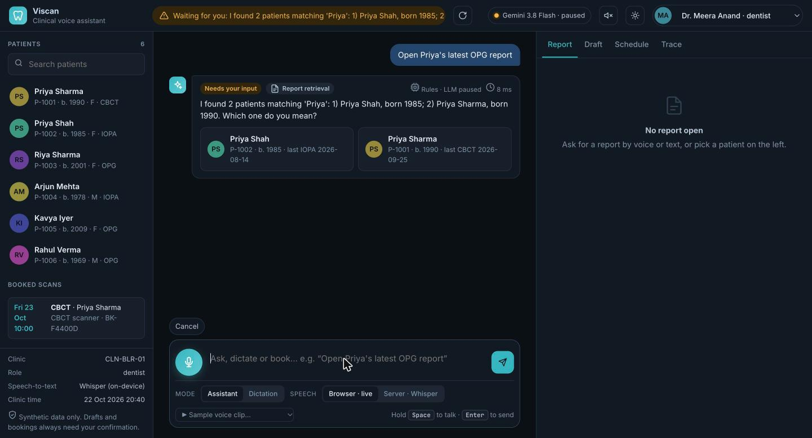
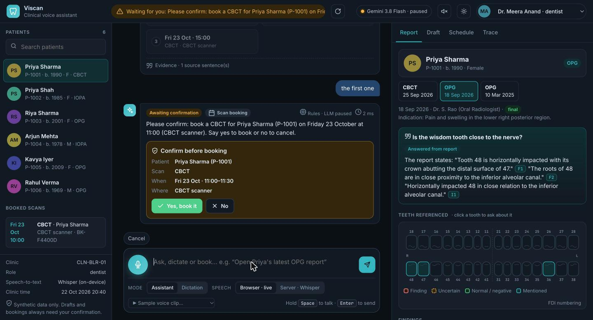
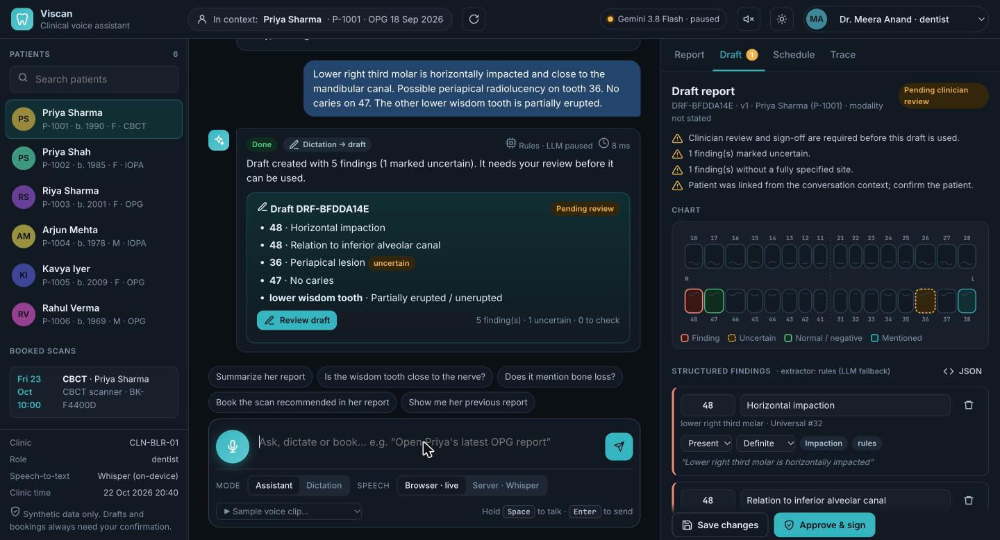
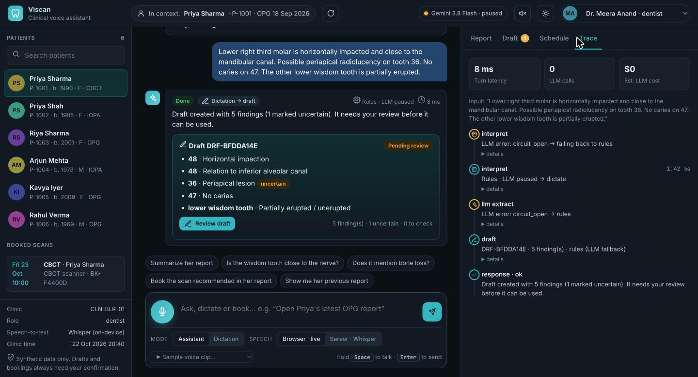

# Viscan voice-first dental assistant (proof of concept)

[](https://github.com/jaygautam-creator/viscan-voice-assistant/actions/workflows/ci.yml)


A small, runnable PoC that lets a dentist, by voice or text:

- **A. Retrieve reports.** For example, "Open Priya's latest OPG report". It handles ambiguous names, likely speech-recognition errors, missing reports and clinic-scoped access safely.
- **B. Dictate findings.** For example, "Lower right third molar is horizontally impacted". The result is an editable, structured JSON draft plus a readable report. Every finding is grounded in the dictation, uncertainty is labelled, and clinician sign-off is required.
- **C. Ask follow-ups.** For example, "Summarize her report", using conversation context, with the source sentences shown for every answer.
- **Bonus 1: report-aware Q&A.** For example, "Is the wisdom tooth close to the nerve?". Answers are grounded and cite sentence IDs.
- **Bonus 2: scan-booking agent.** For example, "Book a CBCT for Priya Sharma tomorrow morning" or "Book the scan recommended in her report". It checks synthetic machine slots and books **only after an explicit yes**.



All data is synthetic. See [`docs/ARCHITECTURE.md`](docs/ARCHITECTURE.md) for the one-page design, [`docs/DEMO.md`](docs/DEMO.md) for a recorded sequence of API calls with real outputs, and [`docs/SUBMISSION_NOTE.md`](docs/SUBMISSION_NOTE.md) for what works, what's incomplete and what's next.

---

## Quick start

Requires Python 3.11+ and [uv](https://docs.astral.sh/uv/).

```bash
make install     # uv sync: core + dev dependencies; offline rules mode works out of the box
make test        # 82 tests, no network or API keys needed
make run         # API + web UI on http://127.0.0.1:8000 (see "Web UI" below)
```

More targets in the [`Makefile`](Makefile): `eval`, `eval-llm`, `demo`, `lint`, `format`, `run-voice`, `audio`.

Optional extras:

```bash
uv sync --extra stt-local            # faster-whisper: real on-device speech-to-text
VISCAN_STT_PROVIDER=local uv run uvicorn app.main:app --port 8000

echo "GEMINI_API_KEY=..." >> .env    # LLM mode: Gemini 3.8 Flash (or ANTHROPIC_API_KEY for Claude)
uv run uvicorn app.main:app --port 8000
```

| Script | Purpose |
|---|---|
| `uv run python scripts/demo.py` | Runs the full scenario against a live server and regenerates `docs/DEMO.md` |
| `uv run python scripts/run_evals.py [--llm] [--cases a,b]` | 31 multi-turn conversation cases, including booking. Reports pass rate, latency, estimated cost, and **how many turns the LLM actually served** versus fell back to rules |
| `uv run python scripts/make_audio_samples.py` | Regenerates the sample voice clips (macOS `say`) and the mock-STT manifest |

### Run modes

| | Interpreter | Dictation extractor | Summary / Q&A |
|---|---|---|---|
| **Offline (no key)** | Rules: regex, gazetteer and anatomy parser | Rules: lexicon and anatomy parser | Extractive, quoting report sentences |
| **LLM mode** (`GEMINI_API_KEY` → Gemini 3.8 Flash; `ANTHROPIC_API_KEY` → Claude Opus 5.5) | LLM **function calling** (7 tools) | LLM **structured JSON output**, then the validator | LLM structured output, then grounding checks |

Both LLM providers implement the same two-method interface (`tool_call`, `json_output`) in [`app/llm/`](app/llm), so the rest of the app is provider-agnostic. In LLM mode, any failure (timeout, quota or rate limit, refusal, malformed output) falls back to the rules path, and the trace records why. After a rate-limit or auth error, a circuit breaker pauses LLM calls for the server's suggested retry delay (capped at 15 minutes), so turns don't each pay for a failed round trip. In every mode, the same deterministic layer does patient resolution, authorization, report selection and grounding validation.

---

## Project structure

Layered so the boundary between "the LLM proposes" and "code decides" is visible in the folder names:

```text
app/
├── main.py                 # API layer: FastAPI app factory, routes, mock auth, error mapping
├── config.py               # settings from env / .env
├── schemas.py              # Pydantic contracts shared by every layer
├── assistant/              # application layer: one conversational turn
│   ├── orchestrator.py     #   interpret -> validate -> execute -> respond, with trace
│   └── sessions.py         #   conversation context, pending questions, drafts (in-memory)
├── understanding/          # language -> structured Intent (proposals only)
│   ├── interpreter.py      #   LLM function-calling router (7 tools) + rules fallback
│   └── normalize.py        #   STT clean-up: "O P G"->OPG, "tooth four eight"->48, dates
├── llm/                    # provider adapters behind one 2-method interface
│   ├── base.py             #   LLM protocol, LLMError, token usage and cost
│   ├── gemini.py           #   Gemini 3.8 Flash (google-genai)
│   ├── claude.py           #   Claude Opus 5.5 (anthropic)
│   └── breaker.py          #   circuit breaker for rate limits / auth failures
├── clinical/               # deterministic domain rules (the "code decides" side)
│   ├── dental.py           #   FDI / Universal / Palmer tooth and site parsing
│   ├── lexicon.py          #   controlled vocabulary, hedges, negation, modifiers
│   └── identity.py         #   patient resolution: exact / ambiguous / fuzzy-confirm
├── features/               # feature services built on the layers above
│   ├── dictation.py        #   dictation -> validated, editable draft report
│   ├── grounding.py        #   cited summaries and report Q&A with grounding checks
│   └── scheduling.py       #   scan-booking diary, time parsing, propose/confirm/commit
├── storage/
│   ├── repository.py       #   mock patients/reports with clinic + role authorisation
│   └── audit.py            #   append-only, IDs-only access log
└── speech/
    └── stt.py              #   STT providers: mock / faster-whisper (local) / OpenAI
static/                     # web UI: index.html, css/, js/ (ES modules, no build step)
data/                       # synthetic clinicians, patients, reports, scan machines
tests/                      # 82 pytest tests (no network; fake LLM + mock STT)
evals/cases.json            # 31 multi-turn conversation cases
scripts/                    # demo generator, eval runner, sample-audio generator
samples/audio/              # 6 synthetic voice clips + mock-STT manifest
docs/                       # architecture, recorded demo, submission note, screenshots
```

---

## Web UI

The UI is plain HTML, CSS and ES modules served by FastAPI, with no build step. It is designed as a clinical workstation rather than a chat demo.

| | |
|---|---|
|  |  |
| **Identity safety.** "Priya" matches two patients, so the assistant shows candidate cards and waits. | **Booking agent.** Real free slots come from the diary, then a confirmation card; nothing is booked without "yes". |
|  |  |
| **Draft editor.** Structured findings with a tooth chart coloured by certainty, review flags and versioned save/approve. | **Pipeline trace.** Every turn's interpretation, fallbacks, validation and tool steps, with tokens and cost. |

**Layout**
- **Left:** clinic patient list with search, booked scans, and live system status (LLM engine and whether its circuit breaker is open, STT provider, clinic clock).
- **Centre:** the voice-first conversation. Rich cards cover patient choice, slot choice, booking confirmation, the booking ticket and draft summaries. Citation chips (`F2`, `I1`) jump to the evidence. Suggestions adapt to the context ("Summarize her report" once a patient is open).
- **Right:**
  - **Report:** study switcher; an interactive **FDI odontogram** (click a tooth to ask about it); the cited sentences are highlighted.
  - **Draft:** structured editor with JSON view; approval stays blocked until every site is specified.
  - **Schedule:** day strip and free-slot grid. Clicking a slot still goes through the confirmation flow.
  - **Trace:** timeline of the turn's steps.

**Voice**
- A mic button with a live waveform; you can also hold **Space** to talk.
- Speech engine: the browser (live interim transcript) or the server (Whisper on-device).
- **Dictation mode** sends long dictation, with the patient in context, to `/api/dictations`.
- Bundled sample clips work without a microphone, and replies can be read aloud.

**Other:** light and dark themes (system default), keyboard support, and responsive down to tablet width. Switching the signed-in user (dentist, radiologist, receptionist) changes what is visible and allowed.

---

## Environment variables

Copy [`.env.example`](.env.example) to `.env` (optional). Key settings:

| Variable | Default | Meaning |
|---|---|---|
| `GEMINI_API_KEY` | unset | Enables Gemini (default model `gemini-3.8-flash`) |
| `ANTHROPIC_API_KEY` | unset | Enables Claude (default model `claude-opus-5-5`); takes precedence when both keys are set |
| `VISCAN_LLM_PROVIDER` | `auto` | `auto` / `gemini` / `anthropic` / `none` |
| `VISCAN_MODEL` | per provider | Override the model for routing, extraction, summary and Q&A |
| `VISCAN_ROUTER_EFFORT` / `VISCAN_EXTRACTION_EFFORT` | `low` / `medium` | Gemini thinking level or Claude effort per route (latency vs care) |
| `VISCAN_LLM_TIMEOUT_S`, `VISCAN_LLM_MAX_RETRIES` | `30`, `1` | Bounded LLM latency before falling back |
| `VISCAN_STT_PROVIDER` | `mock` | `mock` (bundled clips), `local` (faster-whisper), `openai` |
| `VISCAN_WHISPER_MODEL` | `base.en` | faster-whisper model size |
| `VISCAN_DEMO_CLINICIAN` | `dr-anand` | Mock identity when no `X-Clinician-Id` header is sent |

---

## API

All endpoints take `X-Clinician-Id` (mock authentication): `dr-anand` (Bengaluru dentist), `dr-kapoor` (Mumbai radiologist) or `front-desk-blr` (receptionist: can book scans but cannot read clinical reports). Bookings are made only through the conversational confirm flow in `/api/chat`, never by a single API call.

| Method and path | Purpose |
|---|---|
| `POST /api/chat` `{text, session_id?}` | One conversational turn: retrieve, summarize, ask, dictate or clarify |
| `POST /api/chat/audio` (multipart `audio`, `session_id`) | Speech-to-text, then the same turn |
| `POST /api/dictations` `{transcript, patient_id?, modality?}` | Dictation to draft report (JSON plus readable text) |
| `POST /api/dictations/audio` (multipart) | Audio to speech-to-text to draft |
| `GET / PUT /api/dictations/{id}` | Read, or edit the structured draft (optimistic versioning) |
| `POST /api/dictations/{id}/approve` | Clinician sign-off (blocked while sites are unresolved or no patient is linked) |
| `POST /api/transcribe` | Speech-to-text only |
| `GET /api/patients`, `/api/patients/{id}/reports`, `/api/reports/{id}` | Deterministic data access (authorization enforced) |
| `GET /api/slots?modality=CBCT&day=YYYY-MM-DD` | Free scan slots in the caller's clinic (read-only) |
| `GET /api/bookings` | Confirmed scan bookings in the caller's clinic |
| `GET /api/health` | Active interpreter, model and its status (ready or paused), speech-to-text provider, clinic clock |

Every `/api/chat` response includes `status` (`ok`, `needs_clarification`, `not_found`, `forbidden` or `unsupported`), a spoken-style `message`, the structured payload (`report`, `summary`, `answer`, `draft`, `candidates`), the `sources` used as evidence, the conversation `context`, and a `trace` of every interpretation, validation and tool step. Interactive OpenAPI docs are at `/docs`.

---

## Model and provider choices

- **LLM: Gemini 3.8 Flash by default** (`gemini-3.8-flash`, official `google-genai` SDK), with **Claude Opus 5.5** as an alternative (official `anthropic` SDK). Flash fits a voice assistant: it is fast and cheap, and every turn makes at least one routing call. Different tasks use the API differently:
  - **Routing** uses *function calling* with 7 tools and `low` thinking. Gemini runs in forced mode (`mode=ANY`), so a tool is always called. Claude uses `strict` tools with `tool_choice: auto`, because Opus 5.5 rejects forced tool choice. The model only proposes an intent. It never sees patient records, and code validates every argument.
  - **Dictation extraction, summaries and Q&A** use *structured JSON output* (`response_json_schema` on Gemini, `output_config.format` on Claude), so the response always parses. Extraction runs at `medium` thinking.
  - Every call has a timeout and a capped retry (429s excluded), and a circuit breaker sits in front. For Claude, the stable prompt prefix is marked for prompt caching and server-side refusal fallback is enabled.
- **Speech-to-text** sits behind one interface:
  - **Browser Web Speech API**: free; used by the UI mic button in Chrome and Edge.
  - **faster-whisper `base.en` on CPU**: audio stays on the machine; about 0.5 to 0.8 s per short clip on an Apple-silicon laptop.
  - **OpenAI `gpt-4o-transcribe`**: optional.
  - **Mock provider**: deterministic, for CI.
  - All providers get a dental vocabulary prompt, and their output goes through deterministic normalization: "O P G" becomes "OPG", "tooth four eight" becomes "48", "3-6" becomes "36", and "Priyas" becomes "Priya".
- **Why not let the LLM do everything?** In a clinical setting, deciding *which patient's data is shown* and *what is written in a draft* must be auditable and testable. The LLM handles language understanding. Deterministic code makes the decisions.

---

## Production considerations (brief)

**Privacy**
- Synthetic data only.
- Data minimization: the router sees only the utterance plus a name-free session summary (for example "active patient: yes (she/her)"). Extraction sees only the transcript. Summary and Q&A see the report text without patient identifiers.
- Audit logs hold IDs only, with no names, transcripts or report text (a test checks this).
- `VISCAN_STT_PROVIDER=local` keeps audio on-premises.
- **Gemini free tier:** Google may use free-tier prompts and responses to improve its products, so it is acceptable only for synthetic data like this demo. Real patient data needs the paid tier or Vertex AI.
- For real patient data you would also need: a zero-data-retention and processing agreement with the LLM and speech-to-text vendors, regional processing (the API's `inference_geo`), encryption in transit and at rest, retention limits on audio and transcripts, and compliance with India's DPDP Act 2023.

**Authorization**
- Clinic-scoped access plus roles. Patients outside the caller's clinics are invisible: they are never candidates, and direct requests return 404 rather than revealing that they exist. Receptionists get 403 on clinical content.
- Sessions are bound to the clinician who created them.
- Only the author can edit or approve a draft.
- **Actions with side effects need explicit human confirmation.** A booking is committed only when the clinician's own words are an explicit yes; the LLM's interpretation alone is not enough (a test covers this). The slot is re-checked at commit time, and each booking is audit-logged.
- Prompt injection cannot widen access, because the LLM has no data tools. Every lookup is filtered by the caller's identity in code (a test covers this).
- The `X-Clinician-Id` header is a stand-in for verified OIDC/JWT claims.

**Latency**
- The rules path takes about 1 ms per turn.
- Local Whisper takes about 0.5 to 0.8 s per 2 to 5 s clip.
- In LLM mode, each turn makes one routing call, plus one generation call for summaries, Q&A or dictation. Observed live: a Gemini routing call took about 2.2 s at `low` thinking (measured on Gemini 3.5 Flash), and a dictation extraction about 6.4 s at `medium`. A full latency profile for 3.8 Flash is still pending (see Known limitations).
- Mitigations: `minimal` thinking for routing (try `--router-effort minimal` in the eval), a deterministic fast path for unambiguous commands, streaming text-to-speech of `message`, and the circuit breaker, so an outage costs about 0 ms rather than a timeout per turn.

**Model and tool costs**
Gemini 3.8 Flash costs $0.75 per million input tokens and $3.75 per million output tokens (thinking included), through 31 Dec 2026; both double from 2027. Measured from live calls:

| Call | Tokens | Cost |
|---|---|---|
| Routing | 1,925 input, 59 output | **$0.0017 per turn** |
| Dictation extraction | ~620 input, ~980 output including thinking (counts from a Gemini 3.5 Flash call, priced at 3.8 Flash rates) | ~$0.004 |
| Summary or Q&A | ~0.6k input, ~0.3k output | ~$0.0016 (estimated) |

- A busy clinician (about 200 turns a day) costs roughly **$0.35 a day**. On Claude Opus 5.5 ($4 / $20 per million tokens) the same load is about $2.40 a day.
- Local speech-to-text has no per-call cost.
- Every trace includes `est_cost_usd` per LLM call.
- The **free tier** caps Gemini 3.8 Flash at **20 requests per day**, about 10 to 20 turns. That is fine for a demo but not for evaluation or real use, which need a billing-enabled key.

**Failure handling and input validation**
- Pydantic schemas reject unknown fields. There are length limits on text, transcripts and audio, an allow-list of audio types, and a 10 MB upload cap.
- LLM tool arguments are validated: name characters, date format, enums.
- On LLM failure the request falls back to rules. A circuit breaker stops calling a rate-limited or misconfigured provider for a cooldown period.
- Speech-to-text errors return 4xx/5xx with a message that suggests typing instead.
- Unhandled errors return a reference ID, never a stack trace.

---

## Tests

```bash
uv run pytest -q    # 82 tests, ~3 s, no network
```

The assignment requires three test areas: correct retrieval, ambiguous patient identity and unsupported clinical claims. The suite covers those and more:

| File | Covers |
|---|---|
| `test_retrieval.py` | Correct report (latest OPG versus the older OPG and the newer CBCT), selectors, spoken input, missing report, unknown patient, other clinic, receptionist role, executing the LLM's tool call |
| `test_ambiguity.py` | Ambiguous first name or surname, answers by surname, ordinal, birth year or ID, unclear answer re-asks, fuzzy match needs confirmation, the LLM can't bypass disambiguation |
| `test_dictation.py` | The example dictation, hedges and negation, under-specified tooth, unmappable speech surfaced. **Hallucinated LLM output rejected:** invented diagnosis, invented quote, undictated tooth, invented modifier, dropped hedge, invented recommendation. Also LLM omissions caught by coverage, LLM-outage fallback, and edit/version/approve |
| `test_followup.py` | "Summarize her report" from context with sources matching the report text, no-context clarification, pronoun mismatch, grounded and unanswerable Q&A, ungrounded LLM summary bullets dropped, session bound to clinician |
| `test_api_and_failures.py` | Input validation, the audio path with sample clips, audio validation, router outage and malformed tool arguments falling back, prompt injection, audit log containing IDs only |
| `test_llm_wire.py` | The real Anthropic SDK against a local mock server: request shape (strict tools, effort, fallbacks beta, caching) and parsing of tool_use, JSON and refusals |
| `test_gemini_adapter.py` | Gemini adapter with a stubbed client: forced function calling, thinking level, JSON schema, token accounting, mapping of finish reasons and errors (safety, max tokens, malformed call, 429 with retry delay, 5xx), and the circuit breaker failing fast |
| `test_booking.py` | Full propose, confirm and commit flow; no booking on "no", "cancel", "hmm" or "yes but not that one"; **an LLM claiming "yes" isn't enough** (the clinician's own words are checked); scan type taken from the report recommendation with evidence; exact time goes straight to confirmation; slot taken between offer and confirm offers alternatives; ambiguous patient resolved first; receptionist limited to own clinic; non-imaging requests declined; natural-language date and time parsing |
| `test_dental_and_text.py` | FDI, Universal and Palmer tooth parsing, numbers that aren't teeth, speech-to-text normalization, negation, rule intents |

---

## Mock data

`data/` holds 3 clinicians in 2 clinics, 7 patients, 15 reports, and 5 imaging machines (`scan_machines.json`). Scan slots are generated for the next 14 days with a deterministic ~45% pre-booked, to mimic a busy diary.

| Patient | ID | Clinic | Why they're in the dataset |
|---|---|---|---|
| Priya Sharma | P-1001 | Bengaluru | Similar names |
| Priya Shah | P-1002 | Bengaluru | Similar names |
| Riya Sharma | P-1003 | Bengaluru | Similar-sounding first name; shares a surname |
| Arjun Mehta | P-1004 | Bengaluru | Has no CBCT (missing-report case) |
| Kavya Iyer | P-1005 | Bengaluru | Has a cephalogram |
| Rahul Verma | P-1006 | Bengaluru | Two OPGs two years apart |
| Priya Nair | P-2001 | Mumbai | Another clinic, used for the authorization tests |

Every patient has at least 2 reports. All names and content are invented.

## Known limitations

- **The LLM path is only partly verified live.** Gemini accepted the real router tools and extraction schema, and returned correct tool calls and schema-valid findings (probes on Gemini 3.5 Flash and 3.8 Flash). The full 31-case live eval could not run: the free-tier key allows 20 Gemini 3.8 Flash requests a day, and that limit was reached. With a billing-enabled key, `uv run python scripts/run_evals.py --llm` measures LLM-only accuracy, latency and cost. Claude is covered by a mock-server contract test only (no Anthropic key).
- **The rules interpreter and eval set were built together**, so the 31/31 rules score is optimistic. Unusual phrasings fall through to `unsupported` or a clarification, never to a wrong patient.
- **Grounding is lexical and conservative.** It can reject valid paraphrases. For example, "lying on its side" is not accepted as *horizontal*; it goes to "rejected, clinician to review". It also can't catch every semantic error, such as a polarity flip spread across sentences.
- **Spoken tooth numbers are read as FDI.** Universal "#" numbering is shown for display but not parsed from speech.
- **Name matching is spelling-based** (exact, then fuzzy with confirmation). There's no phonetic or transliteration matching yet.
- **Sessions, drafts and bookings are held in memory**, in a single process. The diary is synthetic, with no cancellation or rescheduling flow yet. Auth is mocked. There's no server-side text-to-speech; the browser `speechSynthesis` toggle stands in.
- **Dictation never writes an impression.** That's by design: only what was dictated is structured.
