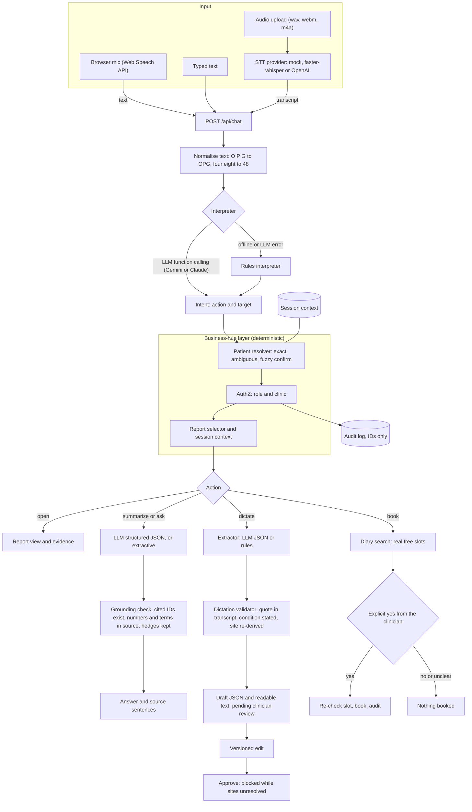

# Architecture (one page)

**Principle: the LLM interprets language; deterministic code decides what data is shown and what goes into a draft.** Every step is recorded in the response `trace`.

### 1. Voice and STT
Audio reaches the server through `/api/chat/audio` or `/api/dictations/audio`. A pluggable `STTProvider` transcribes it:
- `local`: faster-whisper. Audio is decoded to 16 kHz mono with PyAV and stays on the machine.
- `openai`: the OpenAI transcription API.
- `mock`: deterministic; recognises the bundled clips by SHA-256, for CI.

The browser mic uses the Web Speech API and sends plain text. Every transcript passes through one deterministic normaliser before interpretation. That normaliser handles spoken acronyms, spoken or split tooth numbers ("tooth four eight", "3-6"), ordinals, and possessives the STT dropped ("Priyas"). Typed and spoken input therefore follow an identical path.

### 2. LLM interpretation (tool calling)
`LLMInterpreter` sends the utterance and a *name-free* session summary to the configured LLM through one provider interface: Gemini 3.8 Flash by default (`google-genai`), or Claude Opus 5.5 (`anthropic`). Routing uses low thinking. The model gets seven function declarations:
- `open_report`, `summarize_report`, `answer_report_question`
- `draft_report_from_dictation`
- `resolve_pending_question`, `cancel_pending`
- `unsupported_request`

Gemini is forced to call one of them (`mode=ANY`). The tool call is mapped to an `Intent`, and Pydantic validates the arguments (enums, name characters, `YYYY-MM[-DD]` dates). The LLM has **no data-access tools**. It cannot look up, open or write anything; it only proposes.

A timeout, rate limit, refusal, missing tool call or invalid argument triggers the `RuleInterpreter` (regex, a gazetteer of the caller's patients, and the anatomy parser), and the trace records the reason. A circuit breaker then skips the LLM for the provider's retry delay, so an outage or exhausted quota costs no extra latency.

### 3. Tool/API execution (business rules)
The orchestrator runs deterministic "tools" over the repository:
- **Identity.** A report opens only on a unique exact name match. Several matches return candidates (name, birth year, last study) and a pending question. A fuzzy-only match asks for confirmation. The search covers only the caller's clinics.
- **Context.** "her", "his" and "the report" resolve to the session's active patient and report. If there is no context, the assistant asks. If the pronoun contradicts the patient's sex, the assistant asks.
- **Report selection.** Selection is by modality and selector. If nothing matches, the response is `not_found` and lists the reports that *are* available; it never substitutes a different modality or patient.
- **Authorization.** Repository reads require the role permission and clinic membership. An out-of-clinic resource returns 404. A clinical read by a receptionist returns 403. Sessions are bound to their clinician. Every access is written to an IDs-only audit log.

### 4. Report generation (dictation to draft)
1. **Segment** the transcript into clauses deterministically.
2. **Extract** findings. In LLM mode, the model returns JSON through structured outputs: a condition from a controlled vocabulary, a verbatim `evidence_quote`, the site as dictated, presence, certainty and modifiers. In offline mode, the lexicon and anatomy parser do this.
3. **Validate** each LLM claim. A claim is **rejected** if its quote isn't in the transcript, its condition term isn't stated, or its tooth was never dictated. The **site is always re-derived** from the dictated words; FDI is canonical, with Universal for display. Hedges ("possible", "cannot be excluded") force `uncertain`, negation forces `absent`, and modifiers that don't literally appear are dropped. A coverage check surfaces dictated clauses that no finding accounts for, so nothing is silently lost.
4. **Render** the readable draft from a template over the *validated* structure, so no free-text generation reaches the report. The draft always has `status: pending_clinician_review`. Rejected AI claims and unstructured segments are listed for review. The impression is left for the clinician.
5. **Clinician** edits the JSON (versioned `PUT`) and approves. Approval is blocked while any tooth or site is unresolved or no patient is linked.

Summaries and Q&A follow the same pattern. The LLM must cite sentence IDs. Each bullet or answer is kept only if its cited IDs exist, every number and condition term appears in the cited text, and source uncertainty is preserved. Otherwise the extractive answer is used, and the response always includes the source sentences.

### 5. Scan-booking agent (bonus): propose, confirm, commit
1. **Propose.** The LLM (or rules) only extracts *who, which scan and when* ("tomorrow morning", "Friday at 10"). Code then:
   - resolves the patient with the same identity rules as retrieval;
   - parses the time window deterministically;
   - searches the synthetic diary (per-clinic machines and modalities, a share pre-booked);
   - offers at most 3 real free slots, or the earliest alternatives.
   If no scan type was given, it uses the one recommended in the patient's report and cites the sentence.
2. **Confirm.** A chosen slot produces a confirmation card. Only an explicit affirmative in the *clinician's own utterance* books it, so an LLM that over-reads "hmm" as "yes" cannot trigger a booking. "No", unclear replies or a new request leave the diary untouched.
3. **Commit.** The slot is re-checked under a lock. If it was taken in the meantime, alternatives are offered. The booking is audit-logged, and receptionists can book but only for their own clinic's patients.

